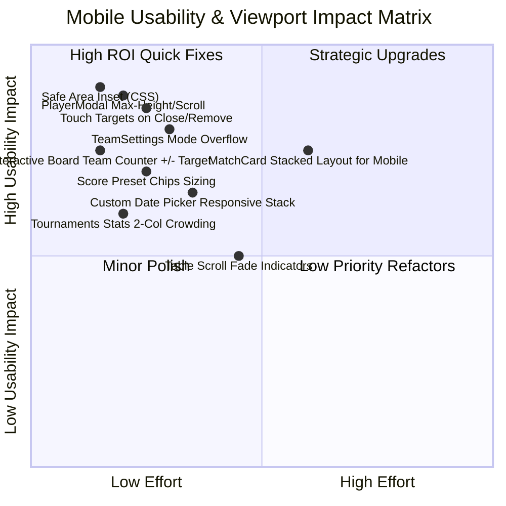

# Mobile Responsive Design & Touch Behavior Audit

**Date:** 2026-10-27  
**Auditor:** Code Health Auditor (Tier: Flash)  
**Target Viewports:** Smartphones 360px – 430px (iPhone SE, iPhone 14/15/16, Samsung Galaxy S22/S23/S24, Google Pixel 7/8)  
**Operating Context:** Outdoor Tennis Court (Touch interaction, bright sunlight, sweaty/one-handed grip, virtual keyboard)  
**Verification Status:** All 63 test suites passed (837 tests passing, 0 failures, TypeScript clean). Zero production files modified.

---

## 1. Executive Summary & Audit Methodology

This comprehensive responsive design audit evaluates the mobile rendering and tactile usability of the Team Generator & Tournament Management Single Page Application. 

The evaluation framework focuses specifically on real-world mobile behavior on tennis courts:
1. **Viewport Constraints (360px – 430px):** Elements bursting out of viewport boundaries, inadvertent horizontal page scrolling, and rigid grid columns.
2. **Touch Target Sizing (WCAG 2.5.5 / 2.5.8):** Minimum 44x44px hit boxes for primary actions and 40x40px for secondary actions to prevent accidental taps with fingers or sweaty hands.
3. **Modal & Virtual Keyboard Ergonomics:** Dialogs clipped off-screen when on-screen keyboards appear on Android and iOS Safari.
4. **Data Table Responsiveness:** Standings and rankings tables handling column density and horizontal overflow wrappers.
5. **Score Input Ergonomics on Court:** Speed, accuracy, and inputMode configurations for tennis score entry.

### Summary Metrics
| Severity | Count | Primary Impact Areas |
|---|---|---|
| **Critical** | 3 | Missing Safe Area Inset (`safe-area-bottom`), Modal keyboard clipping without scroll, Rigid Button Group overflow on 360px |
| **High** | 5 | Sub-44px touch targets on remove/delete buttons, Date range input overflow, Stats summary text wrapping on small phones |
| **Medium** | 6 | Dense score preset chips, Unbounded card header title wrapping, Undiscoverable horizontal table scrolling |
| **Low / Polish** | 4 | Compact padding on small screens (`p-6` vs `p-4 sm:p-6`), Podium card centering on 360px |

---

## 2. Severity Rating & Impact Matrix



---

## 3. Module-by-Module Detailed Findings & Remediation Proposals

### 3.1 Navigation & App Shell

#### Finding NAV-01: Undefined `safe-area-bottom` class & Home Indicator Collision
- **Severity:** Critical
- **Location:** [`MobileNav.tsx#L9`](file:///D:/Projects/team-generator/src/components/layout/MobileNav.tsx#L9), [`index.css`](file:///D:/Projects/team-generator/src/assets/styles/index.css)
- **Description:**  
  `MobileNav.tsx` specifies the class `safe-area-bottom` on the fixed bottom navigation bar:
  ```tsx
  className="md:hidden fixed bottom-0 left-0 right-0 z-50 bg-white/95 dark:bg-slate-900/95 backdrop-blur-md border-t border-gray-200 dark:border-slate-800 transition-colors safe-area-bottom"
  ```
  However, `safe-area-bottom` is **not defined** in `src/assets/styles/index.css` nor in `tailwind.config.js`. On modern bezel-less devices (iPhone X through iPhone 16, Android devices using gesture navigation pills), the bottom navigation bar renders flush against the bottom edge of the physical screen. The 6 navigation icons and their text labels collide directly with the operating system home indicator bar, causing mis-taps and home-swipe conflicts.
- **Symptom on 360px–430px Devices:**  
  Users attempting to tap "Генератор", "Мачове", or "Класиране" accidentally trigger the iOS / Android gesture navigation to switch apps or return home.
- **Remediation Proposal:**  
  Add safe-area utility classes in `src/assets/styles/index.css`:
  ```css
  .safe-area-bottom {
    padding-bottom: env(safe-area-inset-bottom, 0px);
  }
  .safe-area-top {
    padding-top: env(safe-area-inset-top, 0px);
  }
  ```
  Update [`AppShell.tsx#L32`](file:///D:/Projects/team-generator/src/components/layout/AppShell.tsx#L32) to account for dynamic safe-area bottom padding:
  ```tsx
  <main className="flex-1 pb-[calc(4.5rem+env(safe-area-inset-bottom,0px))] md:pb-8 min-h-[calc(100vh-4rem)] flex flex-col">
  ```

---

#### Finding NAV-02: 6 Navigation Items Density on 360px Viewports
- **Severity:** High
- **Location:** [`MobileNav.tsx#L12-L43`](file:///D:/Projects/team-generator/src/components/layout/MobileNav.tsx#L12-L43), [`navigation.ts#L4-L11`](file:///D:/Projects/team-generator/src/constants/navigation.ts#L4-L11)
- **Description:**  
  The bottom navigation bar distributes 6 items horizontally across the screen width:
  `Начало`, `Генератор`, `Играчи`, `Мачове`, `Турнири`, `Класиране`.  
  On a 360px viewport (e.g., Galaxy S8, compact Android devices), available width is 360px minus horizontal padding (8px) = 352px. Each item receives a width of approximately 58px. Cyrillic labels such as "Генератор" (9 letters) and "Класиране" (9 letters) in `text-[10px]` are on the edge of clipping or wrapping onto multiple lines.
- **Symptom on 360px–430px Devices:**  
  When system accessibility font scaling is enabled (e.g., Android large font settings), labels wrap into 2 lines, pushing icon positions upwards and altering bar height unevenly.
- **Remediation Proposal:**  
  1. Add `truncate max-w-full px-0.5` to the text label span in `MobileNav.tsx`.
  2. Alternatively, consider an "Още" (More) dropdown or drawer menu for less frequent tabs on ultra-narrow screens (< 375px), or keep icons prominent with icon-only active indicator labels.

---

#### Finding NAV-03: Mobile Header Theme Toggle Touch Target Sizing
- **Severity:** Medium
- **Location:** [`AppShell.tsx#L25`](file:///D:/Projects/team-generator/src/components/layout/AppShell.tsx#L25), [`ThemeToggle.tsx#L20-L22`](file:///D:/Projects/team-generator/src/components/ui/ThemeToggle.tsx#L20-L22)
- **Description:**  
  In the mobile top header, `ThemeToggle` is rendered without `showLabel`, rendering with `p-2` around a `w-4 h-4` icon. Total rendered size is 32x32px.
- **Symptom on 360px–430px Devices:**  
  Fails the minimum recommended 44x44px touch target guidelines for top app bar icons.
- **Remediation Proposal:**  
  Update `ThemeToggle.tsx` line 21:
  ```tsx
  showLabel ? 'px-3 py-1.5 space-x-2 text-xs font-medium shadow-sm' : 'p-2.5 min-w-[44px] min-h-[44px] flex items-center justify-center'
  ```

---

### 3.2 Generator Module & Interactive Team Board

#### Finding GEN-01: Formation Mode Button Group Overflow on 360px Screens
- **Severity:** Critical
- **Location:** [`TeamSettings.tsx#L91-L116`](file:///D:/Projects/team-generator/src/components/team/TeamSettings.tsx#L91-L116)
- **Description:**  
  In `TeamSettings.tsx`, the formation mode selector button group is styled as:
  ```tsx
  <div className="flex items-center rounded-xl bg-gray-100 dark:bg-gray-800 p-1 border border-gray-200 dark:border-gray-700 self-start">
    <button ...>🤖 Автоматично</button>
    <button ...>📋 Интерактивна дъска (Ръчно)</button>
  </div>
  ```
  `self-start` prevents the container from taking `w-full`. The second button label `"📋 Интерактивна дъска (Ръчно)"` with `px-3 py-1.5` measures ~220px, and `"🤖 Автоматично"` measures ~135px. Total container width is ~360px.  
  When placed inside `GeneratorPage` card with `p-6` (padding 24px left + 24px right = 48px), the available inner card width on a 360px screen is **312px**.
- **Symptom on 360px–430px Devices:**  
  The button group extends 48px outside the card boundary, triggering horizontal viewport scrollbars or clipping the right side of the "Ръчно" button.
- **Remediation Proposal:**  
  Make the button group full-width on mobile and wrap/stack cleanly:
  ```tsx
  <div className="grid grid-cols-1 sm:grid-cols-2 gap-1 rounded-xl bg-gray-100 dark:bg-gray-800 p-1 border border-gray-200 dark:border-gray-700 w-full sm:w-auto">
    <button ... className="w-full text-center py-2 px-3 ...">🤖 Автоматично</button>
    <button ... className="w-full text-center py-2 px-3 ...">📋 Интерактивна дъска</button>
  </div>
  ```

---

#### Finding GEN-02: Microscopic Touch Target for Removing Players from Active Pool
- **Severity:** High
- **Location:** [`ActivePool.tsx#L114-L121`](file:///D:/Projects/team-generator/src/components/generator/ActivePool.tsx#L114-L121)
- **Description:**  
  Inside each player badge in the active pool, the remove button is defined as:
  ```tsx
  <button
    type="button"
    onClick={() => onRemovePlayer(player.id)}
    className="ml-2 -mr-1 p-0.5 text-gray-400 hover:text-red-500 dark:hover:text-red-400 transition-colors rounded-full focus:outline-none cursor-pointer"
    aria-label={`Премахни ${player.name}`}
  >
    <X className="w-3.5 h-3.5" />
  </button>
  ```
  The hit area is approximately 18x18px.
- **Symptom on 360px–430px Devices:**  
  On a tennis court with mobile touch, tapping the remove "x" icon frequently triggers an adjacent element or misses completely.
- **Remediation Proposal:**  
  Increase the touch target with padding and an absolute hit pseudo-element or minimum touch size:
  ```tsx
  className="ml-2 -mr-1 p-1.5 text-gray-400 hover:text-red-500 dark:hover:text-red-400 transition-colors rounded-full focus:outline-none cursor-pointer relative before:content-[''] before:absolute before:-inset-2"
  ```

---

#### Finding GEN-03: Team Card Header Title Collision on Doubles
- **Severity:** Medium
- **Location:** [`TeamCard.tsx#L40-L79`](file:///D:/Projects/team-generator/src/components/team/TeamCard.tsx#L40-L79)
- **Description:**  
  The card header places:
  1. Number badge + Team title (`flex items-center`)
  2. Total Rating Badge (`displayTotalRating`)
  3. Players Count Badge (`{team.players.length} играчи`)
  4. Shuffle button (`p-1 w-3.5 h-3.5`)
  5. Delete button (`p-1 w-3.5 h-3.5`)  
  all within `flex justify-between items-center px-5 py-3`.  
  There is no `truncate` or `min-w-0` on `h3.font-bold`.
- **Symptom on 360px–430px Devices:**  
  When a custom team name is longer than 10 characters, the right-side badges and buttons wrap onto multiple lines or overflow the header bar. Furthermore, the shuffle and delete buttons have a hit area of only 22x22px (`p-1` around `w-3.5 h-3.5`).
- **Remediation Proposal:**  
  1. Add `min-w-0 flex-1 mr-2` to the team title container with `truncate` on the `h3` text.
  2. Enlarge the shuffle and delete buttons to `p-2` with `w-4 h-4` (touch area 36x36px).

---

#### Finding GEN-04: Team Slot Picker Modal Keyboard Visibility
- **Severity:** High
- **Location:** [`TeamSlotPickerModal.tsx#L90-L101`](file:///D:/Projects/team-generator/src/components/team/TeamSlotPickerModal.tsx#L90-L101), [`TeamSlotPickerModal.tsx#L180-L202`](file:///D:/Projects/team-generator/src/components/team/TeamSlotPickerModal.tsx#L180-L202)
- **Description:**  
  `TeamSlotPickerModal` uses `className="... max-h-[90vh]"`. On mobile, it features two text inputs:
  1. Search input at the top (`#playerSearchInput`)
  2. Quick guest name input at the bottom (`#quickGuestNameInput`)  
  When either input is focused on iOS or Android, the virtual keyboard takes 40–50% of the screen height. The modal remains centered on screen, which pushes the header or the bottom guest form outside the visible viewport.
- **Symptom on 360px–430px Devices:**  
  Users typing a guest name cannot see what they are typing because the bottom input is pushed below the virtual keyboard, and the submit button cannot be tapped without dismissing the keyboard first.
- **Remediation Proposal:**  
  Adopt a bottom-sheet presentation on mobile:
  ```tsx
  className="fixed inset-0 z-50 flex items-end sm:items-center justify-center p-0 sm:p-4 bg-black/50 backdrop-blur-xs"
  // Dialog:
  className="bg-white dark:bg-slate-800 rounded-t-2xl sm:rounded-2xl shadow-xl w-full max-w-md max-h-[85dvh] flex flex-col"
  ```
  Using `dvh` (Dynamic Viewport Height) ensures the modal automatically resizes when the virtual keyboard appears.

---

### 3.3 Players Module

#### Finding PLY-01: PlayerModal Overflow on Small Screens with Virtual Keyboard
- **Severity:** Critical
- **Location:** [`PlayerModal.tsx#L153-L177`](file:///D:/Projects/team-generator/src/components/player/PlayerModal.tsx#L153-L177)
- **Description:**  
  `PlayerModal` renders 4 input fields: Name, Overall Rating, Singles Rating, Doubles Rating, plus Header and Footer actions.  
  The modal dialog container is declared without height constraints or scroll overflow:
  ```tsx
  <div
    className="bg-white dark:bg-gray-800 rounded-2xl shadow-2xl max-w-md w-full p-6 text-gray-900 dark:text-gray-100 relative transition-all"
    onClick={(e) => e.stopPropagation()}
    ...
  >
  ```
  Total natural content height of this modal is ~520px.
- **Symptom on 360px–430px Devices:**  
  On an iPhone SE (screen height 667px), when the user taps any rating input, the virtual keyboard consumes ~300px, leaving only ~367px of visible height. The bottom buttons ("Отказ", "Запази") are completely hidden off the bottom of the screen. Because the modal lacks `overflow-y-auto`, the user **cannot scroll down** to tap "Запази" while the keyboard is active.
- **Remediation Proposal:**  
  Update `PlayerModal.tsx#L153`:
  ```tsx
  className="bg-white dark:bg-gray-800 rounded-2xl shadow-2xl max-w-md w-full p-5 sm:p-6 text-gray-900 dark:text-gray-100 relative transition-all max-h-[90dvh] overflow-y-auto"
  ```

---

#### Finding PLY-02: Player List Mobile Card Action Touch Targets
- **Severity:** Medium
- **Location:** [`PlayersPage.tsx#L298-L314`](file:///D:/Projects/team-generator/src/pages/PlayersPage.tsx#L298-L314)
- **Description:**  
  On mobile cards in `PlayersPage.tsx`, the edit and delete buttons are styled as:
  ```tsx
  <button className="p-2 text-gray-500 hover:text-indigo-600 rounded-lg hover:bg-gray-100 transition-colors">
    <Pencil className="w-5 h-5" />
  </button>
  ```
  The computed hit target is 36x36px (20px icon + 16px padding).
- **Symptom on 360px–430px Devices:**  
  Slightly below the recommended 44x44px minimum touch target.
- **Remediation Proposal:**  
  Increase button padding from `p-2` to `p-2.5` (or `min-w-[44px] min-h-[44px] flex items-center justify-center`).

---

### 3.4 Matches Module & Tennis Score Ergonomics

#### Finding MAT-01: Custom Date Range Filter Row Inadvertent Overflow
- **Severity:** High
- **Location:** [`MatchesPage.tsx#L274-L297`](file:///D:/Projects/team-generator/src/pages/MatchesPage.tsx#L274-L297)
- **Description:**  
  When the period filter is set to `'custom'`, `MatchesPage.tsx` displays two native HTML `type="date"` input controls side-by-side:
  ```tsx
  <div className="flex items-center gap-2 bg-white dark:bg-gray-800 px-2.5 py-1 rounded-xl border ...">
    <div className="flex items-center gap-1">
      <span>От:</span>
      <input type="date" value={customStartDate} className="px-2 py-0.5 ... text-xs" />
    </div>
    <div className="flex items-center gap-1">
      <span>До:</span>
      <input type="date" value={customEndDate} className="px-2 py-0.5 ... text-xs" />
    </div>
  </div>
  ```
  On iOS Safari and Android Chrome, native date inputs have minimum internal layout requirements (often 120–140px per picker to show date text and native calendar indicator). In a single non-wrapping flex row with labels and padding, this component requires ~310px width.
- **Symptom on 360px–430px Devices:**  
  When placed next to or wrapping below the period `<select>` dropdown (which takes ~160px), it forces horizontal page scrolling or truncates the "До:" date picker on 360px viewports (360px - 32px padding = 328px inner space).
- **Remediation Proposal:**  
  Allow the date picker container to wrap into a 2-column grid on mobile:
  ```tsx
  <div className="grid grid-cols-2 gap-2 bg-white dark:bg-gray-800 p-2 rounded-xl border border-gray-200 dark:border-gray-700 shadow-xs text-xs w-full sm:w-auto">
    <div className="flex items-center gap-1.5">
      <span className="text-gray-500 text-[11px] font-medium shrink-0">От:</span>
      <input type="date" className="w-full px-2 py-1 rounded-lg border text-xs ..." />
    </div>
    <div className="flex items-center gap-1.5">
      <span className="text-gray-500 text-[11px] font-medium shrink-0">До:</span>
      <input type="date" className="w-full px-2 py-1 rounded-lg border text-xs ..." />
    </div>
  </div>
  ```

---

#### Finding MAT-02: Regular MatchCard Stacked Reading Hierarchy on Mobile
- **Severity:** Medium
- **Location:** [`MatchCard.tsx#L428-L515`](file:///D:/Projects/team-generator/src/components/match/MatchCard.tsx#L428-L515)
- **Description:**  
  In `MatchCard.tsx` (standard non-playoff mode), the layout uses:
  ```tsx
  <div className="grid grid-cols-1 md:grid-cols-7 gap-4 items-center">
    <div className="md:col-span-3 text-left">{/* Team 1 */}</div>
    <div className="md:col-span-1 flex flex-col items-center">{/* Score Board */}</div>
    <div className="md:col-span-3 text-left md:text-right">{/* Team 2 */}</div>
  </div>
  ```
  On desktop (`md:col-span-*`), this renders horizontally: `[Team 1] [ Score ] [Team 2]`.  
  On mobile (`grid-cols-1`), this stacks vertically as:
  1. Team 1 Name & Players
  2. Score Board (e.g. `6 : 4` or `6:4, 3:6, 10:8`)
  3. Team 2 Name & Players
- **Symptom on 360px–430px Devices:**  
  In multi-set matches, reading a centered score block detached between Team 1 and Team 2 requires cognitive gymnastics (which set number belongs to which side?). In contrast, the playoff variant (`playoff-team-row-1` and `playoff-team-row-2`) renders each team with its score cleanly aligned on the right.
- **Remediation Proposal:**  
  Unify the standard `MatchCard` mobile layout with the playoff 2-row stacked pattern, showing Team 1 with its scores on the right, a subtle divider, and Team 2 with its scores on the right.

---

#### Finding MAT-03: Court Usability of Tennis Score Preset Chips
- **Severity:** High
- **Location:** [`TennisScoreEditor.tsx#L309-L337`](file:///D:/Projects/team-generator/src/components/match/TennisScoreEditor.tsx#L309-L337)
- **Description:**  
  `TennisScoreEditor` provides quick score chips (`6:0`, `6:1`, `6:2`, `6:3`, `6:4`, `7:5`, `7:6`). While this is functionally excellent, the chips are styled as:
  ```tsx
  className="px-2 py-0.5 text-xs font-semibold rounded-md bg-indigo-50 hover:bg-indigo-100 text-indigo-700 ..."
  ```
  The computed height of each chip is only 22px to 24px, packed tightly in a `gap-1` cluster.
- **Symptom on 360px–430px Devices:**  
  On a sunny tennis court with sweaty hands or when operating the device with one thumb, tapping a 22px chip easily triggers the wrong preset (e.g., tapping `6:1` instead of `6:2`).
- **Remediation Proposal:**  
  Increase the hit area of preset chips to minimum 36px height on touch devices:
  ```tsx
  className="px-2.5 py-1.5 min-h-[36px] flex items-center justify-center text-xs font-bold rounded-lg bg-indigo-50 active:scale-95 transition-transform ..."
  ```

---

#### Finding MAT-04: MatchModal Double Scrollbar Trap on Mobile
- **Severity:** Medium
- **Location:** [`MatchModal.tsx#L374-L386`](file:///D:/Projects/team-generator/src/components/match/MatchModal.tsx#L374-L386)
- **Description:**  
  In `MatchModal.tsx`, both the fixed backdrop container AND the modal card have `overflow-y-auto`:
  ```tsx
  <div className="fixed inset-0 z-50 flex items-center justify-center p-4 bg-black/50 backdrop-blur-xs overflow-y-auto">
    <div className="bg-white dark:bg-gray-800 rounded-2xl shadow-2xl max-w-2xl w-full p-6 my-8 max-h-[90vh] overflow-y-auto">
  ```
- **Symptom on 360px–430px Devices:**  
  On mobile touchscreens, nested scroll containers cause "scroll-jacking": scrolling gestures inside the modal frequently get absorbed by the outer backdrop or lock up, making it frustrating to reach the bottom save button.
- **Remediation Proposal:**  
  Remove `overflow-y-auto` from the outer backdrop container and structure the modal dialog as a flex column: fixed header, `flex-1 overflow-y-auto` body, and fixed bottom actions footer.

---

### 3.5 Tournaments Module

#### Finding TRN-01: TournamentsPage Stats Grid Crowding on 360px Devices
- **Severity:** High
- **Location:** [`TournamentsPage.tsx#L127-L183`](file:///D:/Projects/team-generator/src/pages/TournamentsPage.tsx#L127-L183)
- **Description:**  
  The stats summary row on `TournamentsPage.tsx` uses `grid grid-cols-2 lg:grid-cols-4 gap-4`.  
  On a 360px screen with page padding `px-4` (32px total), available width is 328px. With a 16px gap, each card width is `(328 - 16) / 2 = 156px`.  
  Inside each card:
  - Card padding `p-5` consumes 40px.
  - Icon container `w-12 h-12` (48px) + `gap-4` (16px) consumes 64px.  
  Total consumed width is 104px, leaving **only 52px** for the title and counter.
- **Symptom on 360px–430px Devices:**  
  Longer Bulgarian labels like "Приключили" (10 characters) and "Чернови" (7 characters) wrap awkwardly, pushing the counter down and creating mismatched card heights across the 2 columns.
- **Remediation Proposal:**  
  Adjust the padding and layout on extra-small screens:
  ```tsx
  <div className="grid grid-cols-2 lg:grid-cols-4 gap-3 sm:gap-4 mb-6">
    <div className="p-3.5 sm:p-5 flex items-center gap-2.5 sm:gap-4 ...">
      <div className="w-9 h-9 sm:w-12 sm:h-12 rounded-xl shrink-0 ...">
        <Trophy className="w-5 h-5 sm:w-6 sm:h-6" />
      </div>
      <div className="min-w-0">
        <p className="text-xs font-medium text-gray-500 truncate">Приключили</p>
        <p className="text-xl sm:text-2xl font-bold">{stats.completed}</p>
      </div>
    </div>
  ```

---

#### Finding TRN-02: TournamentsPage Status Filter 4-Pill Width Boundary
- **Severity:** Medium
- **Location:** [`TournamentsPage.tsx#L189-L234`](file:///D:/Projects/team-generator/src/pages/TournamentsPage.tsx#L189-L234)
- **Description:**  
  The status segmented control renders 4 buttons: "Всички", "В ход", "Чернови", "Приключили" in a single non-wrapping flex container with `self-start`:
  `px-3.5 py-1.5` on 4 buttons plus borders and container padding totals ~325px.
- **Symptom on 360px–430px Devices:**  
  On a 360px phone screen (inner width 328px), this pill control has only 3px of clearance. On devices with bold system font or slightly higher DPI scaling, it overflows the right edge.
- **Remediation Proposal:**  
  Add `overflow-x-auto max-w-full scrollbar-none` or make it responsive:
  ```tsx
  <div className="flex items-center rounded-xl bg-gray-100 dark:bg-gray-800 p-1 border border-gray-200 dark:border-gray-700 overflow-x-auto max-w-full">
  ```

---

#### Finding TRN-03: TournamentInteractiveBoard Team Counter Hit Targets
- **Severity:** High
- **Location:** [`TournamentInteractiveBoard.tsx#L669-L697`](file:///D:/Projects/team-generator/src/components/tournament/TournamentInteractiveBoard.tsx#L669-L697)
- **Description:**  
  The target team count stepper uses:
  ```tsx
  <button
    id="decrementTeamCountBtn"
    className="w-8 h-8 flex items-center justify-center rounded-xl border ..."
  >
    -
  </button>
  <input className="w-16 text-center py-1.5 px-2 ..." />
  <button
    id="incrementTeamCountBtn"
    className="w-8 h-8 flex items-center justify-center rounded-xl border ..."
  >
    +
  </button>
  ```
  `w-8 h-8` translates to 32x32px.
- **Symptom on 360px–430px Devices:**  
  Stepping team count up or down is difficult with fingers on a mobile touchscreen, frequently resulting in miss-taps or unintended input focus.
- **Remediation Proposal:**  
  Enlarge the buttons to `w-10 h-10` or `w-11 h-11` (40px to 44px) on mobile:
  ```tsx
  className="w-10 h-10 sm:w-8 sm:h-8 flex items-center justify-center rounded-xl font-bold ..."
  ```

---

#### Finding TRN-04: Undiscoverable Horizontal Scrolling in GroupStandingsTable
- **Severity:** Medium
- **Location:** [`GroupStandingsTable.tsx#L55-L81`](file:///D:/Projects/team-generator/src/components/group/GroupStandingsTable.tsx#L55-L81)
- **Description:**  
  `GroupStandingsTable.tsx` properly wraps the table in `<div className="overflow-x-auto">`. The table has a minimum width of ~436px (columns: #, Отбор, М, П, З, +/-, Т).  
  On a 360px–390px mobile viewport, the points ("Т") and goal/game difference ("+/-") columns are clipped on the right edge. Because there is no scrollbar visible by default on mobile Safari or Android, and no gradient fade indicator, users often don't realize the table can be scrolled horizontally to see points.
- **Symptom on 360px–430px Devices:**  
  Users cannot easily see team points ("Т") without swiping blindly.
- **Remediation Proposal:**  
  Add a subtle right-side gradient shadow indicator when scrollable content exists, or add a swipe hint icon / badge on mobile:
  ```tsx
  <div className="relative">
    <div className="overflow-x-auto scrollbar-thin">
      <table ...>...</table>
    </div>
    {/* Right edge scroll affordance hint */}
    <div className="pointer-events-none absolute right-0 top-0 bottom-0 w-6 bg-gradient-to-l from-white dark:from-slate-800 to-transparent sm:hidden" />
  </div>
  ```

---

#### Finding TRN-05: TournamentScoreModal Doubles Teams Header Crowding
- **Severity:** Medium
- **Location:** [`TournamentScoreModal.tsx#L184-L235`](file:///D:/Projects/team-generator/src/components/tournament/TournamentScoreModal.tsx#L184-L235)
- **Description:**  
  In `TournamentScoreModal.tsx`, the match matchup summary is laid out in a 5-column grid:
  ```tsx
  <div className="grid grid-cols-5 gap-2 my-5 items-center bg-gray-50 ... p-3.5 rounded-xl">
    <div className="col-span-2 text-left">{/* Team 1 */}</div>
    <div className="col-span-1 text-center font-bold text-xs">vs</div>
    <div className="col-span-2 text-right">{/* Team 2 */}</div>
  </div>
  ```
  On a 360px screen with modal padding `p-6` (24px each side = 48px) and outer padding (32px), inner width is 280px. Each team receives `(280 * 2) / 5 = 112px`.
- **Symptom on 360px–430px Devices:**  
  In doubles matches with two players per team, player badges wrap and truncate after just 4–5 letters, making it hard to identify the players.
- **Remediation Proposal:**  
  1. Reduce modal padding on mobile to `p-4 sm:p-6`.
  2. In the matchup header, stack each team vertically on narrow screens:
  ```tsx
  <div className="flex flex-col sm:grid sm:grid-cols-5 gap-2 my-4 p-3 rounded-xl bg-gray-50 dark:bg-gray-700/30">
  ```

---

### 3.6 Rankings Module & Podium

#### Finding RNK-01: Podium Display Scaling on 360px Screens
- **Severity:** Low / Polish
- **Location:** [`Podium.tsx#L17-L99`](file:///D:/Projects/team-generator/src/components/rankings/Podium.tsx#L17-L99)
- **Description:**  
  `Podium.tsx` handles mobile responsiveness well by using `flex-col sm:flex-row items-center sm:items-end` with flex ordering (`order-1` for Champion on top, `order-2` for 2nd place, `order-3` for 3rd place).  
  However, each card is constrained to `max-w-[240px]` (or `max-w-[260px]` for 1st place). On a 360px–390px phone, this leaves ~60–80px of unused horizontal space on either side while player names truncate prematurely inside `max-w-full`.
- **Symptom on 360px–430px Devices:**  
  Cards look narrow and player names truncate even though screen width is available.
- **Remediation Proposal:**  
  Make cards full width on mobile up to a comfortable max:
  ```tsx
  className="order-1 sm:order-2 flex-1 w-full sm:max-w-[260px] flex flex-col items-center"
  ```

---

## 4. Global Design System & Touch Target Enhancements

### 4.1 Button Primitive Sizing Standard
The core [`Button`](file:///D:/Projects/team-generator/src/components/ui/Button.tsx) component in `src/components/ui/Button.tsx` currently defines:
```ts
const sizeClasses = {
  sm: 'px-3 py-1.5 text-xs',      // Computed height: ~28-30px (Fails 44px guideline)
  md: 'px-4 py-2.5 text-sm',      // Computed height: ~38-40px (Fails 44px guideline)
  lg: 'px-6 py-3.5 text-base ...', // Computed height: ~48-52px (Passes 44px guideline)
};
```
**Recommended Design System Enhancement:**
Add a mobile touch target wrapper or ensure `min-h-[44px]` for interactive standalone buttons, or enforce a minimum tap target with transparent hit margins:
```ts
const sizeClasses = {
  sm: 'px-3 py-1.5 text-xs min-h-[36px] sm:min-h-[32px]',
  md: 'px-4 py-2.5 text-sm min-h-[44px]',
  lg: 'px-6 py-3.5 text-base font-bold min-h-[48px]',
};
```

### 4.2 Modal Dialog Container Standard
Across `PlayerModal.tsx`, `TournamentModal.tsx`, `MatchModal.tsx`, and `TournamentScoreModal.tsx`, there are inconsistencies in container declaration:
- Some lack `max-h` or `overflow-y-auto` (`PlayerModal.tsx`).
- Some have double nested scrollbars (`MatchModal.tsx`).
- Some use `p-6` on mobile, consuming 48px of precious horizontal width.

**Standard Recommended Modal Architecture:**
```tsx
{/* Backdrop */}
<div className="fixed inset-0 z-50 flex items-end sm:items-center justify-center p-0 sm:p-4 bg-black/50 backdrop-blur-xs">
  {/* Dialog Card */}
  <div className="bg-white dark:bg-gray-800 rounded-t-2xl sm:rounded-2xl shadow-2xl w-full max-w-lg max-h-[90dvh] flex flex-col overflow-hidden">
    {/* Fixed Header */}
    <div className="p-4 sm:p-6 border-b shrink-0 flex items-center justify-between">...</div>
    {/* Scrollable Body */}
    <div className="p-4 sm:p-6 overflow-y-auto flex-1">...</div>
    {/* Fixed Footer */}
    <div className="p-4 sm:p-6 border-t shrink-0 flex items-center justify-end gap-3">...</div>
  </div>
</div>
```

---

## 5. Prioritized Implementation Roadmap

Following the project's strict scoping and ticket hierarchy, this audit can be converted into the following scoped tickets:

### Phase 1: Critical Usability & Viewport Overflow Fixes (Ticket: `fix/mobile-viewport-safe-areas`)
1. **Define Safe Area Utilities:** Add `.safe-area-bottom` and `.safe-area-top` in `src/assets/styles/index.css`.
2. **Fix `TeamSettings.tsx` Mode Selector Overflow:** Make formation mode pills full-width with `grid grid-cols-1 sm:grid-cols-2` on mobile.
3. **Resolve `PlayerModal.tsx` Height Clipping:** Add `max-h-[90dvh] overflow-y-auto` and bottom sheet alignment.
4. **Fix `MatchesPage.tsx` Custom Date Range Filter:** Responsive 2-column grid for date inputs on mobile.

### Phase 2: Touch Ergonomics & Outdoor Court Enhancements (Ticket: `fix/mobile-touch-targets`)
1. **Enlarge ActivePool & TeamCard Remove Buttons:** Increase hit targets from 18px to minimum 36px–40px.
2. **Enlarge TennisScoreEditor Preset Chips:** Increase chip height from `py-0.5` (22px) to `py-1.5 min-h-[36px]` for reliable one-tap score entry.
3. **Enlarge Interactive Board Stepper Buttons:** Change `decrementTeamCountBtn` and `incrementTeamCountBtn` from `w-8 h-8` to `w-10 h-10` on mobile.
4. **Tournaments Page Stats Cards Padding:** Change from rigid `p-5` to `p-3.5 sm:p-5` with icon scaling to prevent text wrapping on 360px screens.

### Phase 3: Layout Polish & Readability Upgrades (Ticket: `chore/mobile-layout-polish`)
1. **MatchCard Layout Alignment:** Standardize standard match cards with the playoff 2-row layout on mobile.
2. **GroupStandingsTable Horizontal Affordance:** Add right-edge gradient fade to signal scrollable columns.
3. **Podium Card Width Scaling:** Expand podium cards to full width on mobile (`w-full sm:max-w-[260px]`).

---
*Report generated strictly in read-only mode by Code Health Auditor. No application source code in `src/` was modified.*
