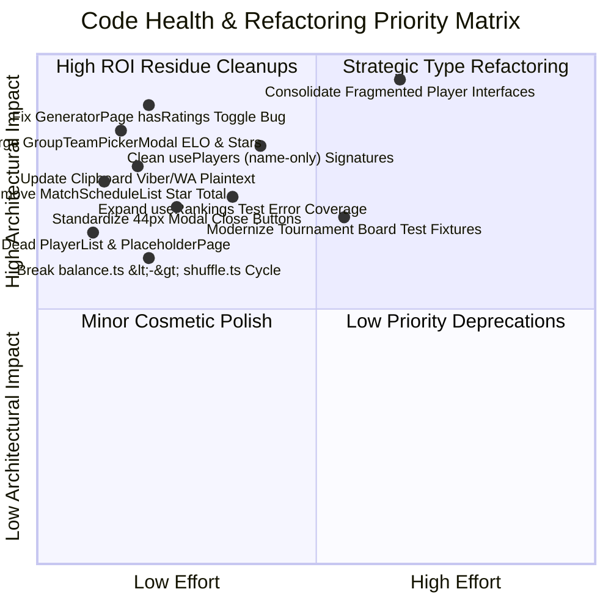

# Code Health Audit & Remediation Proposal: 2026-11-02

**Date:** 2026-11-02  
**Auditor:** Code Health Auditor (Tier: Flash)  
**Verification Baseline:** 69 test files passing (917 passed, 0 failed), TypeScript typecheck clean (`tsc --noEmit`), ESLint clean (`eslint src`).  
**Production Modification Status:** ZERO edits made to production code in `src/`. Read-only analysis.  

---

## 1. Executive Summary & Verification Baseline

Following the successful transitions to sports-based standings ([ADR-0046](file:///D:/Projects/team-generator/docs/adr/0046-deprecation-of-legacy-elo-subsystem.md), [ADR-0047](file:///D:/Projects/team-generator/docs/adr/0047-pure-sports-standings-and-form-tracking.md)), format-aware win rate balancing ([ADR-0048](file:///D:/Projects/team-generator/docs/adr/0048-generator-winrate-balance-and-column-alignment.md)), and sports win rate badges ([ADR-0049](file:///D:/Projects/team-generator/docs/adr/0049-player-selection-winrate-badges.md)), this code health audit systematically inspects the entire repository for:

1. **Legacy ELO / Rating Residue:** Dormant rating fields, unpruned UI star badges, obsolete fallback resolvers, clipboard rating strings, and outdated copy.
2. **Dead Code & Unused Modules:** Completely unreferenced components, orphaned exports, and cyclic utility dependencies.
3. **Type Safety & Schema Decoupling:** Severe `Player` interface fragmentation across 5 type definitions, required legacy fields forcing synthetic `1200` dummy data, and obsolete 4-parameter player mutation signatures.
4. **Test Suite Health & Coverage:** Gaps in `useRankings.ts` error paths, pervasive legacy rating mocks across tests, and zero win rate test assertions in tournament interactive boards.
5. **Mobile Responsiveness & Touch Ergonomics (360px – 430px):** Sub-44px touch targets on modal close buttons and player action icons, alongside viewport crowding on ultra-compact mobile screens.

### Audit Test & Coverage Baseline
- **Total Test Suites:** 69 passing (100%)
- **Total Tests:** 917 passing (100%)
- **Overall Code Coverage:** Statements: **90.87%**, Branches: **81.33%**, Functions: **89.28%**, Lines: **90.87%**
- **Uncovered Outliers:**
  - [`PlaceholderPage.tsx`](file:///D:/Projects/team-generator/src/components/layout/PlaceholderPage.tsx): **0.00%** (completely dead)
  - [`PlayerList.tsx`](file:///D:/Projects/team-generator/src/components/player/PlayerList.tsx): **0.00%** (completely dead)
  - [`useRankings.ts`](file:///D:/Projects/team-generator/src/hooks/useRankings.ts): **65.67%** (untested error paths and fallbacks)

---

## 2. Severity Rating & Prioritized Matrix



---

## 3. Detailed Audit Findings by Category

### 3.1 Category 1: Legacy ELO & Rating Residue

#### Finding 1.1: Direct Omission in `GroupTeamPickerModal.tsx` (Star Icons & ELO Ratings)
- **File:** [`src/components/group/GroupTeamPickerModal.tsx#L58-L196`](file:///D:/Projects/team-generator/src/components/group/GroupTeamPickerModal.tsx#L58-L196)
- **Problem:** When ADR-0049 replaced chess star ratings and total ratings with sports win rate badges across `TeamSlotPickerModal`, `TeamCard`, and `GroupCard`, `GroupTeamPickerModal` was overlooked. It still contains:
  1. Team search filter indexing raw total rating: `if (t.totalRating !== undefined && String(t.totalRating).includes(q)) return true;` ([line 58](file:///D:/Projects/team-generator/src/components/group/GroupTeamPickerModal.tsx#L58)).
  2. Legacy `displayTotalRating` calculation aggregating `p.singles_rating ?? p.rating ?? 0` ([lines 141-155](file:///D:/Projects/team-generator/src/components/group/GroupTeamPickerModal.tsx#L141-L155)).
  3. Star rating badge on team headers: `<Badge variant="amber" size="sm" icon={Star}>{displayTotalRating}</Badge>` ([lines 169-173](file:///D:/Projects/team-generator/src/components/group/GroupTeamPickerModal.tsx#L169-L173)).
  4. Raw ELO stars on player rows: `★{playerRating}` ([lines 178-196](file:///D:/Projects/team-generator/src/components/group/GroupTeamPickerModal.tsx#L178-L196)).
- **Impact:** Inconsistent UI experience during tournament group stage team slotting, re-introducing chess ratings that conflict with pure sports standings.
- **Proposed Solution:** Refactor `GroupTeamPickerModal.tsx` in alignment with ADR-0049: remove `displayTotalRating` and the star badge from team headers; replace `★{playerRating}` with the format-aware `getPlayerWinRate(p, format)` badge (`{winRate}%`, `"Нов"`, or `"Гост"`).

#### Finding 1.2: Residual Star Badge in `MatchScheduleList.tsx`
- **File:** [`src/components/group/MatchScheduleList.tsx#L202-L227`](file:///D:/Projects/team-generator/src/components/group/MatchScheduleList.tsx#L202-L227)
- **Problem:** `MatchScheduleList` displays aggregate star rating chips next to team names in match rows:
  ```tsx
  {match.team1.totalRating !== undefined && match.team1.totalRating > 0 && (
    <span className="text-xs text-indigo-600 dark:text-indigo-400 font-medium">
      ★ {match.team1.totalRating}
    </span>
  )}
  ```
- **Impact:** Tournament match schedule lists present arbitrary rating numbers next to team names.
- **Proposed Solution:** Remove the `★ {match.team1.totalRating}` and `★ {match.team2.totalRating}` spans from `MatchScheduleList.tsx`.

#### Finding 1.3: Generator Balancing Toggle Inconsistency in `GeneratorPage.tsx`
- **File:** [`src/pages/GeneratorPage.tsx#L211-L219`](file:///D:/Projects/team-generator/src/pages/GeneratorPage.tsx#L211-L219)
- **Problem:** `GeneratorPage` computes `hasRatings` using exclusively legacy rating properties:
  ```typescript
  const hasRatings = useMemo(
    () =>
      activePool.some((p) =>
        mode === 'tennis'
          ? ((format === 'doubles' ? p.doubles_rating : p.singles_rating) ?? p.rating) !== undefined
          : p.rating !== undefined
      ),
    [activePool, mode, format]
  );
  ```
  However, in `useTeamGenerator.ts` ([lines 683-684](file:///D:/Projects/team-generator/src/hooks/useTeamGenerator.ts#L683-L684)), `hasRatings` is evaluated via `resolvePlayerRating(p, effectiveFormat) !== undefined`, which includes players with match history (`singles_matches_played > 0` or `winRate`).
- **Impact:** If registered players have match records but their legacy `rating` columns are omitted or deprecated in future migrations, `hasRatings` evaluates to `false` in `GeneratorPage`, erroneously hiding the balancing toggle in `TeamSettings.tsx`.
- **Proposed Solution:** Align `GeneratorPage.tsx` with `useTeamGenerator.ts` by checking if any player has format-aware match history or legacy rating:
  ```typescript
  const hasBalancingData = useMemo(
    () => activePool.some((p) => p.source === 'registered'),
    [activePool]
  );
  ```

#### Finding 1.4: Legacy Clipboard Plaintext Formatting in `src/utils/clipboard.ts`
- **File:** [`src/utils/clipboard.ts#L189-L266`](file:///D:/Projects/team-generator/src/utils/clipboard.ts#L189-L266)
- **Problem:** When sharing generated teams or tournament groups to Viber, WhatsApp, or clipboard:
  - Line 198: Formats `${team.name} (Общ рейтинг: ${team.totalRating}):`
  - Line 209: Formats `- ${player.name} (★ ${r})`
  - Line 264: Formats `${p.name} (★ ${r})`
- **Impact:** Even though the UI now showcases clean player names and win rates, users pasting tournament draws into group chats receive confusing chess ELO numbers (`★ 1200`).
- **Proposed Solution:** Update `formatTeamsForClipboard` and `formatGroupsForClipboard` to either output clean player rosters without raw ratings or output sports win rates (e.g. `Иван Иванов (80% победи)` / `Георги Петров (Нов)`).

#### Finding 1.5: Outdated Copy in `LandingPage.tsx` and `TeamSettings.tsx`
- **Files:**
  - [`src/pages/LandingPage.tsx#L171`](file:///D:/Projects/team-generator/src/pages/LandingPage.tsx#L171): Marketing copy states `"Интелигентно автоматично разпределение според реален ELO рейтинг на играчите. Край на неравностойните състави."`
  - [`src/components/team/TeamSettings.tsx#L294`](file:///D:/Projects/team-generator/src/components/team/TeamSettings.tsx#L294): Setting label reads `"Балансирай отборите по рейтинг на играчите"`.
- **Impact:** Users are informed that the application operates on chess ELO, despite the full transition to match win rate balancing (ADR-0048).
- **Proposed Solution:**
  - Update `LandingPage.tsx` to: `"Интелигентно автоматично разпределение според реалната успеваемост и победи на играчите. Край на неравностойните състави."`
  - Update `TeamSettings.tsx` to: `"Балансирай отборите по успеваемост (процент победи)"`.

---

### 3.2 Category 2: Dead Code, Unused Imports & Circular Dependencies

#### Finding 2.1: Orphaned Component `src/components/layout/PlaceholderPage.tsx`
- **File:** [`src/components/layout/PlaceholderPage.tsx`](file:///D:/Projects/team-generator/src/components/layout/PlaceholderPage.tsx)
- **Problem:** Originally proposed in early architectural iterations for stub pages. Now, `MatchesPage`, `PlayersPage`, and `RankingsPage` are fully functional production modules. `PlaceholderPage.tsx` is completely unreferenced across `src/` and has **0% test coverage**.
- **Impact:** Dead maintenance surface, unused bundle footprint.
- **Proposed Solution:** Safely delete `src/components/layout/PlaceholderPage.tsx`.

#### Finding 2.2: Orphaned Component `src/components/player/PlayerList.tsx`
- **File:** [`src/components/player/PlayerList.tsx`](file:///D:/Projects/team-generator/src/components/player/PlayerList.tsx)
- **Problem:** Not imported by any file in `src/` (not even tests). It retains deprecated rating stars (`<Star className="w-3 h-3 fill-current inline mr-0.5" />{player.rating}`). Has **0% test coverage**.
- **Impact:** Completely dead code containing legacy ELO residue.
- **Proposed Solution:** Safely delete `src/components/player/PlayerList.tsx`.

#### Finding 2.3: Unreferenced Component `src/components/player/PlayerInput.tsx`
- **File:** [`src/components/player/PlayerInput.tsx`](file:///D:/Projects/team-generator/src/components/player/PlayerInput.tsx)
- **Problem:** Retains legacy quick-add with rating input (`+ Бързо добавяне с рейтинг`). The production application uses `ActivePool` and `GuestInput` inside the generator, and `PlayerModal` inside `PlayersPage`. `PlayerInput.tsx` is imported **only** in its own test suite [`PlayerInput.test.tsx`](file:///D:/Projects/team-generator/src/components/player/__tests__/PlayerInput.test.tsx).
- **Impact:** Dead UI component requiring ongoing test maintenance.
- **Proposed Solution:** Deprecate and delete `PlayerInput.tsx` and `PlayerInput.test.tsx`, along with `PlayerInputProps` in `src/types/index.ts`.

#### Finding 2.4: Circular Module Dependency Between `balance.ts` and `shuffle.ts`
- **Files:**
  - [`src/utils/balance.ts#L2-L20`](file:///D:/Projects/team-generator/src/utils/balance.ts#L2-L20)
  - [`src/utils/shuffle.ts#L2-L28`](file:///D:/Projects/team-generator/src/utils/shuffle.ts#L2-L28)
- **Problem:**
  - `src/utils/balance.ts` imports `fisherYatesShuffle` from `./shuffle`, and re-exports `shuffleTeamsBalanced` from `./shuffle`.
  - `src/utils/shuffle.ts` imports `balanceTeams` from `./balance`.
- **Impact:** Cyclic module dependency can lead to undefined module evaluations during SSR, testing, or tree-shaking optimizations.
- **Proposed Solution:** Keep `fisherYatesShuffle` as a pure array shuffler in `shuffle.ts` with no imports from `balance.ts`. Implement or move `shuffleTeamsBalanced` directly into `balance.ts` or a unified team-distribution utility.

#### Finding 2.5: Unused Export `formatMatchScoreDisplay` in `src/utils/standings.ts`
- **File:** [`src/utils/standings.ts#L76-L100`](file:///D:/Projects/team-generator/src/utils/standings.ts#L76-L100)
- **Problem:** Exported function `formatMatchScoreDisplay` is only imported and tested in `standings.test.ts`. All match components format their own scores inline.
- **Proposed Solution:** Evaluate whether to adopt `formatMatchScoreDisplay` across `MatchCard.tsx` / `MatchScheduleList.tsx`, or remove it if redundant.

---

### 3.3 Category 3: Type Safety Improvements & Rating Deprecation

#### Finding 3.1: Interface Fragmentation for `Player` Model
- **Problem:** The repository has 5 distinct, conflicting definitions for a "Player":
  1. [`src/types/player.ts`](file:///D:/Projects/team-generator/src/types/player.ts): Requires `singles_rating: number; doubles_rating: number;` and non-optional match counters.
  2. [`src/types/index.ts`](file:///D:/Projects/team-generator/src/types/index.ts): Defines optional `rating?`, `singles_rating?`, `doubles_rating?`, optional match counters, and adds `isGuest?: boolean; source?: 'registered' | 'guest';`.
  3. [`src/types/generator.ts`](file:///D:/Projects/team-generator/src/types/generator.ts): Defines `GeneratorPlayer` (with `source: PlayerSource`) and `DatabasePlayer` (demanding `rating: number`).
  4. [`src/types/database.types.ts`](file:///D:/Projects/team-generator/src/types/database.types.ts): Defines `PlayerRow` from Supabase schema.
  5. [`src/components/match/PlayerCombobox.tsx`](file:///D:/Projects/team-generator/src/components/match/PlayerCombobox.tsx): Defines `ComboboxPlayer` with `rating?: number`.
- **Impact:**
  - Because `src/types/player.ts` mandates `singles_rating: number`, [`useRankings.ts#L144-L145`](file:///D:/Projects/team-generator/src/hooks/useRankings.ts#L144-L145) is forced to inject synthetic dummy values:
    ```typescript
    singles_rating: p?.singles_rating ?? 1200,
    doubles_rating: p?.doubles_rating ?? 1200,
    ```
  - Developers importing `Player` from `'../types'` receive a completely different type contract than those importing from `'../types/player'`.
- **Proposed Solution:**
  - Unify domain models in `src/types/player.ts`. Mark `singles_rating` and `doubles_rating` as optional (`singles_rating?: number; doubles_rating?: number;`).
  - Re-export the canonical `Player` from `src/types/index.ts` instead of re-declaring a shadowed interface.
  - Eliminate `ComboboxPlayer` in favor of `{ id: string; name: string }`.

#### Finding 3.2: Dead `rating` Field in `RankingStats` Interface
- **File:** [`src/types/rankings.ts#L8`](file:///D:/Projects/team-generator/src/types/rankings.ts#L8)
- **Problem:** `RankingStats` declares `rating: number; // Backward compatibility fallback (1200)`. Neither `RankingsTable.tsx` nor `RankingsMobile.tsx` consumes this field.
- **Proposed Solution:** Mark `rating?: number;` as optional deprecated in `RankingStats`, or remove it entirely.

#### Finding 3.3: Strict `rating_before` and `rating_after` in `MatchPlayer`
- **File:** [`src/types/match.ts#L31-L32`](file:///D:/Projects/team-generator/src/types/match.ts#L31-L32)
- **Problem:** `MatchPlayer` defines:
  ```typescript
  rating_before: number | null;
  rating_after: number | null;
  ```
  Since ELO recalculation was removed in ADR-0046, match creation always records `null`. Having these as mandatory fields forces every unit test and mock fixture in the codebase to specify `rating_before: null, rating_after: null`.
- **Proposed Solution:** Change to optional: `rating_before?: number | null; rating_after?: number | null;`.

#### Finding 3.4: Obsolete 4-Parameter Player Mutation Signatures
- **Files:**
  - [`src/hooks/usePlayers.ts#L100-L162`](file:///D:/Projects/team-generator/src/hooks/usePlayers.ts#L100-L162)
  - [`src/components/player/PlayerModal.tsx#L10-L15`](file:///D:/Projects/team-generator/src/components/player/PlayerModal.tsx#L10-L15)
  - [`src/pages/PlayersPage.tsx#L40-L58`](file:///D:/Projects/team-generator/src/pages/PlayersPage.tsx#L40-L58)
- **Problem:**
  - `createPlayer` signature: `(name: string, rating?: number, singlesRating?: number, doublesRating?: number) => Promise<void>`.
  - `updatePlayer` signature: `(id: string, name: string, rating?: number, singlesRating?: number, doublesRating?: number) => Promise<void>`.
  - `PlayerModal` has no UI inputs for ratings, so it fakes them upon submission:
    ```typescript
    await onSave(
      name.trim(),
      player?.rating ?? 1200,
      player?.singles_rating ?? 1200,
      player?.doubles_rating ?? 1200
    );
    ```
- **Proposed Solution:**
  - Streamline `onSave` in `PlayerModal` to `(name: string) => Promise<void>`.
  - Streamline `createPlayer(name: string)` and `updatePlayer(id: string, name: string)`. Database defaults (`DEFAULT 1200.00`) handle underlying column values automatically without client involvement.

---

### 3.4 Category 4: Test Suite Health & Coverage

#### Finding 4.1: Untested Error Paths in `useRankings.ts`
- **File:** [`src/hooks/useRankings.ts#L99-L119`](file:///D:/Projects/team-generator/src/hooks/useRankings.ts#L99-L119)
- **Problem:** Test coverage for `useRankings.ts` is only **65.67%**. Lines 99-105 (`playersRes.error`, `matchesRes.error`), 111-114 (error message setting), and unmounted abort behavior are not covered in `useRankings.test.ts`.
- **Proposed Solution:** Add unit tests simulating:
  1. Supabase database query failure on `players` fetch.
  2. Supabase database query failure on `matches` fetch.
  3. Graceful degradation when `isSupabaseConfigured() === false`.

#### Finding 4.2: Missing Sports Win Rate Coverage in `TournamentInteractiveBoard.test.tsx`
- **File:** [`src/components/tournament/__tests__/TournamentInteractiveBoard.test.tsx`](file:///D:/Projects/team-generator/src/components/tournament/__tests__/TournamentInteractiveBoard.test.tsx)
- **Problem:** All 31 tests in `TournamentInteractiveBoard.test.tsx` construct mock players with `rating: 1200` and teams with `totalRating: 2400`. There are **0 tests** asserting that win rate badges (`80%`, `"Нов"`, `"Гост"`) render correctly inside the interactive team board slots.
- **Proposed Solution:** Modernize `TournamentInteractiveBoard.test.tsx` fixtures to include match statistics (`doubles_matches_played`, `doubles_wins`) and assert that sports win rate pills render as expected.

#### Finding 4.3: Deprecated Rating Assertions in `PlayerModal.test.tsx` & `usePlayers.test.ts`
- **Files:**
  - [`src/components/player/__tests__/PlayerModal.test.tsx#L80-L112`](file:///D:/Projects/team-generator/src/components/player/__tests__/PlayerModal.test.tsx#L80-L112)
  - [`src/hooks/__tests__/usePlayers.test.ts#L243-L315`](file:///D:/Projects/team-generator/src/hooks/__tests__/usePlayers.test.ts#L243-L315)
- **Problem:** Tests explicitly assert that `handleSave` and `createPlayer` pass dummy ELO ratings (`1200, 1200, 1200`), cementing legacy rating residue in the test suite.
- **Proposed Solution:** Update test suites to assert pure player name persistence once `createPlayer` / `updatePlayer` signatures are cleaned up.

---

### 3.5 Category 5: Mobile Responsive UI & Touch Target Ergonomics

#### Finding 5.1: Sub-44px Touch Targets on Modal Close Buttons
- **Files:**
  - [`src/components/player/PlayerModal.tsx#L108-L116`](file:///D:/Projects/team-generator/src/components/player/PlayerModal.tsx#L108-L116)
  - [`src/components/match/MatchModal.tsx#L394-L402`](file:///D:/Projects/team-generator/src/components/match/MatchModal.tsx#L394-L402)
  - [`src/components/tournament/TournamentModal.tsx#L148-L156`](file:///D:/Projects/team-generator/src/components/tournament/TournamentModal.tsx#L148-L156)
  - [`src/components/tournament/DeleteTournamentModal.tsx#L118-L126`](file:///D:/Projects/team-generator/src/components/tournament/DeleteTournamentModal.tsx#L118-L126)
  - [`src/components/match/DeleteMatchModal.tsx#L40-L48`](file:///D:/Projects/team-generator/src/components/match/DeleteMatchModal.tsx#L40-L48)
  - [`src/components/player/DeletePlayerModal.tsx#L42-L50`](file:///D:/Projects/team-generator/src/components/player/DeletePlayerModal.tsx#L42-L50)
  - [`src/components/tournament/TournamentScoreModal.tsx#L171-L178`](file:///D:/Projects/team-generator/src/components/tournament/TournamentScoreModal.tsx#L171-L178)
  - [`src/components/group/GroupTeamPickerModal.tsx#L105-L112`](file:///D:/Projects/team-generator/src/components/group/GroupTeamPickerModal.tsx#L105-L112)
- **Problem:** All modal dialogs use raw `<button onClick={onClose}><X className="w-5 h-5" /></button>` without padding or with only `p-1`. On physical mobile screens (360px – 430px), this yields a hit box of only **20x20px to 28x28px**, failing WCAG 2.5.5 / 2.5.8 recommendations (min 44x44px).
- **Impact:** Mis-clicks and frustration when attempting to dismiss dialogs on mobile phones outdoors.
- **Proposed Solution:** Standardize modal close buttons across all 8 dialogs:
  ```tsx
  <button
    type="button"
    onClick={onClose}
    aria-label="Затвори"
    className="min-w-[44px] min-h-[44px] flex items-center justify-center p-2.5 rounded-xl text-gray-400 hover:text-gray-600 dark:hover:text-gray-200 hover:bg-gray-100 dark:hover:bg-slate-700/60 transition-colors"
  >
    <X className="w-5 h-5" />
  </button>
  ```

#### Finding 5.2: Sub-44px Mobile Card Action Buttons in `PlayersPage.tsx`
- **File:** [`src/pages/PlayersPage.tsx#L245-L261`](file:///D:/Projects/team-generator/src/pages/PlayersPage.tsx#L245-L261)
- **Problem:** Mobile player cards render Edit and Delete icon buttons with `p-2` and `w-5 h-5`, creating a 36x36px touch target.
- **Proposed Solution:** Apply `min-w-[44px] min-h-[44px] flex items-center justify-center` to mobile card action buttons.

#### Finding 5.3: Team Count Selector Button Sizing in `TournamentInteractiveBoard.tsx`
- **File:** [`src/components/tournament/TournamentInteractiveBoard.tsx#L675-L700`](file:///D:/Projects/team-generator/src/components/tournament/TournamentInteractiveBoard.tsx#L675-L700)
- **Problem:** Team count decrement/increment buttons use `className="w-10 h-10 sm:w-8 sm:h-8"`. On `sm:` screens this reduces to 32x32px, and on mobile it is 40x40px (under 44px).
- **Proposed Solution:** Upgrade to `w-11 h-11 sm:w-10 sm:h-10` (44x44px on mobile) to ensure effortless tapping when adjusting tournament team counts.

#### Finding 5.4: 5-Column Grid Density in `TournamentScoreModal.tsx` on 360px Viewports
- **File:** [`src/components/tournament/TournamentScoreModal.tsx#L184`](file:///D:/Projects/team-generator/src/components/tournament/TournamentScoreModal.tsx#L184)
- **Problem:** The team matchup preview uses `grid grid-cols-5`. On a 360px viewport, each team gets only ~120px of width, which causes double player names in doubles format to truncate severely.
- **Proposed Solution:** Use a flexible responsive layout: `flex flex-col sm:grid sm:grid-cols-5` or stack team names on viewports under 400px.

---

## 4. Proposed Action Items & Implementation Roadmap

To maintain clean Git hygiene and adhere strictly to the engineering workflow, these proposals are organized into three isolated, independently executable tickets:

### Ticket 1: Purge Legacy Rating Residue & Fix Balancing Toggle (`fix/purge-legacy-rating-residue`)
- **Scope:**
  - `src/components/group/GroupTeamPickerModal.tsx`: Remove `displayTotalRating`, star icons, and replace with win rate badges.
  - `src/components/group/MatchScheduleList.tsx`: Remove `★ {totalRating}` badges.
  - `src/pages/GeneratorPage.tsx`: Fix `hasRatings` logic to check `registered` player existence rather than legacy rating numbers.
  - `src/utils/clipboard.ts`: Update clipboard strings to omit obsolete `(★ ...)` and `(Общ рейтинг: ...)`.
  - `src/pages/LandingPage.tsx` & `src/components/team/TeamSettings.tsx`: Update Bulgarian copy to reflect win rate balancing.
  - Update corresponding unit tests.

### Ticket 2: Dead Code Removal & Modular Decoupling (`chore/prune-dead-code-and-cycles`)
- **Scope:**
  - Delete unreferenced `src/components/layout/PlaceholderPage.tsx`.
  - Delete unreferenced `src/components/player/PlayerList.tsx`.
  - Delete unreferenced `src/components/player/PlayerInput.tsx` and its test file.
  - Break circular dependency between `src/utils/balance.ts` and `src/utils/shuffle.ts` by keeping `shuffle.ts` independent.
  - Remove unused `formatMatchScoreDisplay` or adopt it in match cards.

### Ticket 3: Domain Type Unification & 44px Mobile Touch Targets (`refactor/types-and-mobile-touch-targets`)
- **Scope:**
  - Unify `Player` interface in `src/types/player.ts` with optional rating fields.
  - Make `rating_before` and `rating_after` optional in `MatchPlayer` (`src/types/match.ts`).
  - Streamline `createPlayer(name)` and `updatePlayer(id, name)` in `usePlayers.ts` and `PlayerModal.tsx`.
  - Upgrade modal close buttons across all 8 modals to `min-w-[44px] min-h-[44px]`.
  - Upgrade player card actions in `PlayersPage.tsx` to 44x44px.
  - Add missing test coverage for `useRankings.ts` error branches.
  - Modernize `TournamentInteractiveBoard.test.tsx` fixtures with win rate assertions.

---

## 5. Verification & Compliance Sign-off

- [x] Dual-Language Boundary verified (Report in English, UI copy quotes in Bulgarian).
- [x] Zero production edits made to `src/`.
- [x] Full test suite green (69 test files, 917 tests passing).
- [x] Lint and typecheck clean.
